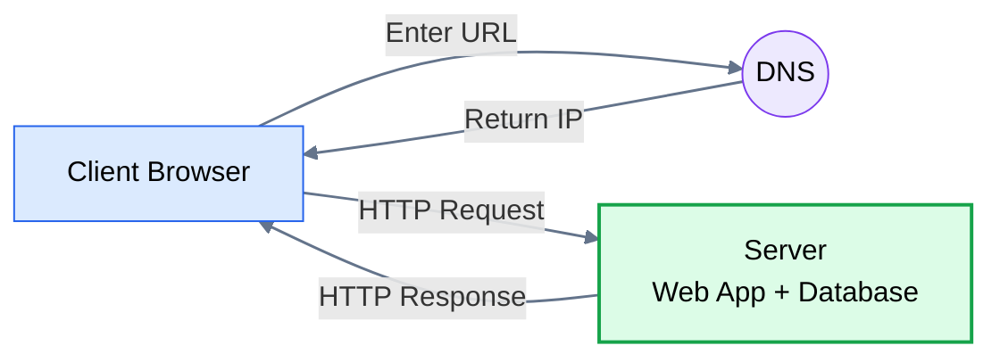
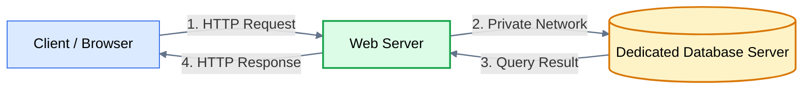
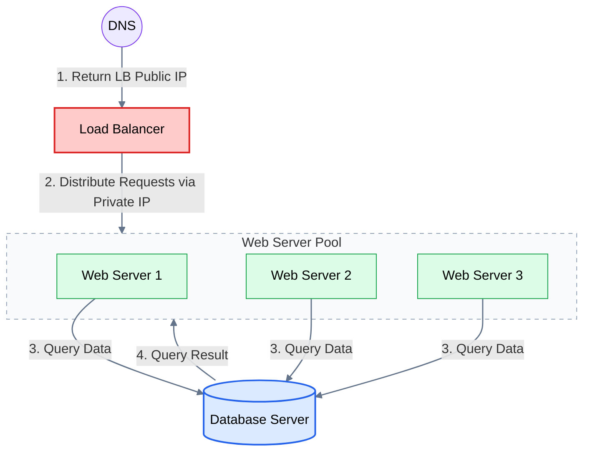
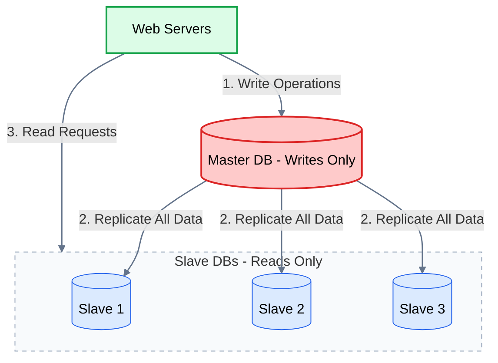
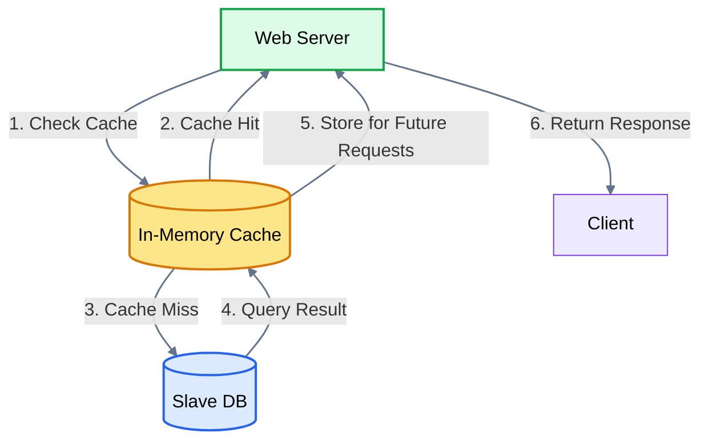
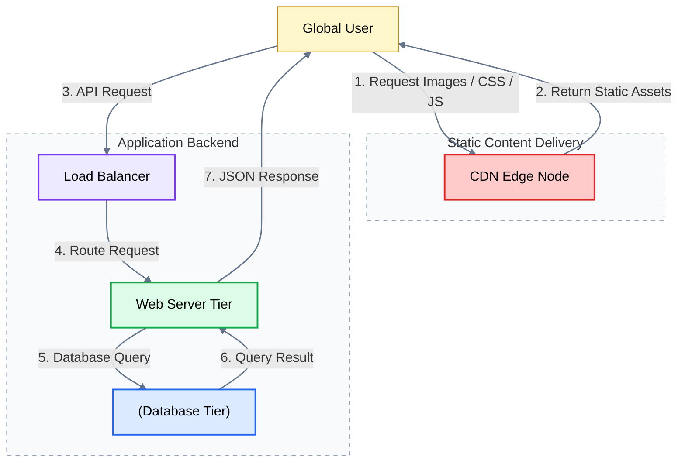
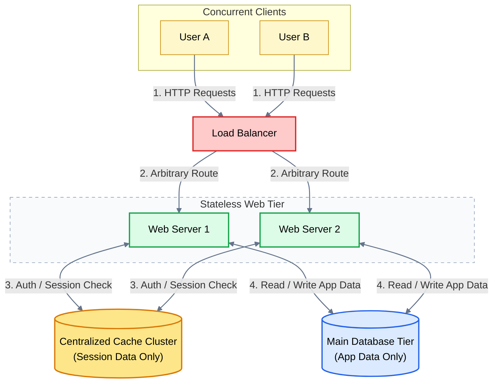
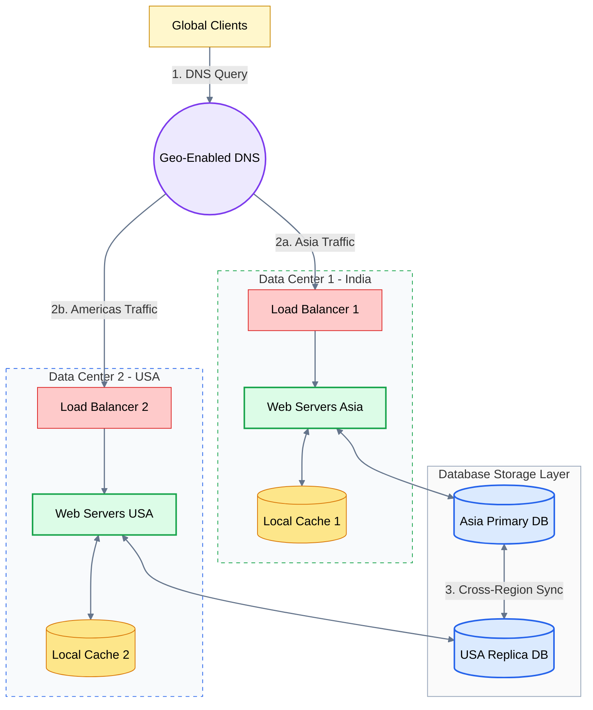
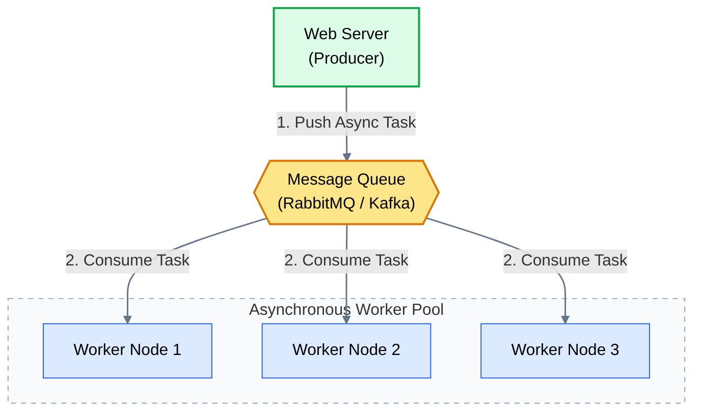
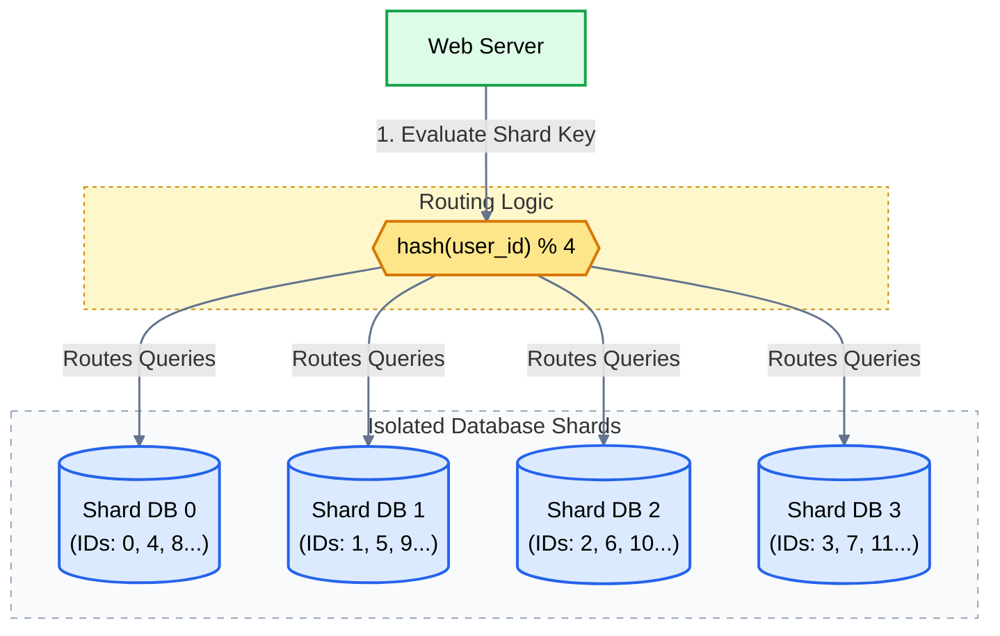

# System Design: Scaling from 0 to 100 Million Users

## The Core Philosophy of System Design

> **Golden Rule:** Every architecture pattern exists because a previous, simpler solution hit a physical or practical bottleneck. Do not add complexity until scale forces you to.

---

## Stage 0: The Genesis (Single Server Architecture)

### 1. First-Thought Idea
> *"I wrote a web app. I'll put my web framework, business logic, and database all inside one single machine (e.g., an AWS EC2 instance). When someone visits my domain, they hit this machine."*

### 2. How It Works
1. The user types `www.example.com` in their browser.
2. A **DNS (Domain Name System)** lookup resolves the human-readable domain name into the server's Public IP address.
3. The client sends an HTTP request (`GET`, `POST`, `PUT`, `DELETE`) with headers and a JSON/HTML payload.
4. The server processes the request, reads/writes to its local database on disk, and returns an HTTP response (JSON / HTML).

### 3. The Flaws & Bottlenecks
- **Single Point of Failure (SPOF):** If the server operating system crashes, the disk corrupts, or the hardware overheats, the entire business goes offline.
- **Resource Contention:** The web server process and the database engine fight for the exact same CPU cores and RAM.
- **Vertical Scaling Limit:** We can only upgrade a single machine up to a certain limit (adding more RAM/CPU). Beyond a certain point, supercomputers become outrageously expensive or physically impossible to scale further.

---

## Stage 1: Separating Web Tier and Database Tier

### 1. First-Thought Idea
> *"Since the web server and database are fighting for memory and CPU, let’s separate them into two dedicated machines: one for the Web Server and one for the Database Server."*

### 2. Decision Point: Relational (SQL) vs. Non-Relational (NoSQL)
Now that the database lives on its own machine, what type of database engine should we install?

| Feature | Relational (SQL) | Non-Relational (NoSQL) |
| :--- | :--- | :--- |
| **Examples** | MySQL, PostgreSQL, Oracle SQL | DynamoDB, MongoDB, Cassandra, Neo4j |
| **Data Format** | Structured tables with strict schemas, rows & columns | Key-Value, Document (JSON), Wide-column, Graph |
| **Strengths** | Strict ACID transactions, complex JOIN queries, relations | Ultra-low latency lookups, schema flexibility, easy horizontal scaling |
| **First-Thought Rule** | Choose when data integrity, finance, and relations matter most. | Choose when dealing with unstructured data, massive write throughput, or real-time low-latency lookups. |

### 3. The Flaws & Bottlenecks
- The web server is still a Single Point of Failure.
- If 10,000 concurrent users visit at the same second, the single web server's thread pool exhausts, connections drop, and requests time out.

---

## Stage 2: Introducing Load Balancer & Horizontal Web Scaling

### 1. First-Thought Idea
> *"Let’s run multiple web servers in parallel! But if we have 5 web servers, which IP does the user type in their browser? A user can’t choose between 5 IPs."*

### 2. The Solution: Load Balancer (LB)
A Load Balancer acts as a traffic cop at the entry gate. It sits in front of multiple identical servers and distributes incoming user requests among them based on various algorithms.

- **Public IP vs. Private IP:**
  - The Load Balancer gets a **Public IP** address exposed to the open internet via DNS.
  - The Web Servers sit behind the Load Balancer with **Private IP** addresses (unreachable directly from the internet for security).
- **Health Checks:** The LB periodically pings web servers. If Web Server A crashes, the LB stops routing traffic to it and sends requests to healthy servers.
- **Auto-Scaling:** As CPU/traffic spikes past a threshold (e.g., 70%), new web servers automatically spin up and register with the Load Balancer.

### 3. The Flaws & Bottlenecks
- The web tier can scale horizontally to infinity, but all web servers query one single database.
- The database machine experiences CPU throttling, connection pool limits, and disk I/O bottlenecks.
- The database is now the ultimate Single Point of Failure (SPOF).

---

## Stage 3: Database Scaling (Master-Slave / Primary-Replica)

### 1. First-Thought Idea
> *"In almost all web applications (Twitter, Instagram, E-commerce), users read data way more than they write data (typical ratio: 90% reads, 10% writes). Why force the write server to handle all reads too?"*

### 2. The Solution: Master-Slave Architecture
- **Master (Primary) DB:** Handles all write operations (`INSERT`, `UPDATE`, `DELETE`).
- **Slave (Replica) DBs:** Handle all read operations (`SELECT`).
- **Replication:** Data written to the Master is asynchronously replicated to all Slave nodes.
- **Failover Mechanism:** If the Master node crashes, one of the Slave nodes is elected and promoted to become the new Master (using consensus/voting algorithms).

### 3. The Flaws & Bottlenecks
- **Replication Lag:** The Slave nodes are always slightly behind the Master. If a user updates their profile (write) and immediately refreshes (read), they might see stale data.
- **Master Bottleneck:** The Master node can still be overwhelmed if write volume is extremely high (e.g., viral events like Black Friday).
- **Disk I/O Latency:** Every read still hits a physical storage disk. Disk lookups are slow compared to RAM.

---

## Stage 4: Introducing the Cache Tier

### 1. First-Thought Idea
> *"Reading from disk is slow. RAM is thousands of times faster. What if we keep frequently accessed data in fast memory so we rarely touch the database?"*

### 2. The Solution: In-Memory Cache (Redis / Memcached)
Sits between the Web Tier and the Database Tier.

**Cache-Aside Pattern:**
1. Web server checks the cache for data.
2. **Cache Hit:** Data found in RAM; return immediately (sub-millisecond latency).
3. **Cache Miss:** Data not in RAM; query the Database, write the result into Cache, and return to user.

### 3. The Flaws & Bottlenecks
- Dynamic API data is now blazing fast. But what about static assets (images, video thumbnails, CSS, JavaScript files)?
- If our servers are in Mumbai, an Indian user experiences low latency, but a user in New York suffers high latency due to geographical distance and physical network hops.

---

## Stage 5: Content Delivery Network (CDN) & Edge Caching

### 1. First-Thought Idea
> *"Don't make a user travel halfway across the globe just to download an image or a CSS file. Store copies of static files physically close to them."*

### 2. The Solution: CDN (CloudFront, Akamai)
A CDN is a globally distributed network of proxy servers (Points of Presence / Edge locations).

**When a user requests a static asset (image/CSS/JS):**
1. The CDN serves it from the edge server nearest to the user.
2. If not present, the CDN fetches it from the origin server once, caches it locally, and serves all future users nearby from the edge.

### 3. The Flaws & Bottlenecks
- The app is fast and handles millions of reads. But as traffic grows, users report: *"I was logged in on Server 1, but my next click sent me to Server 2 and suddenly I’m logged out!"*

---

## Stage 6: Stateless Web Tier & Session Management

### 1. First-Thought Idea
> *Why did the user get logged out? Because Server 1 saved their session token in its local memory. When the Load Balancer routed request #2 to Server 2, Server 2 had no clue who the user was.*

### 2. Bad Fix: Sticky Sessions (Stateful Architecture)
- Instruct the Load Balancer to always send User A to Server A.
- **Flaw:** If Server A crashes, User A is kicked out. If Server A gets overloaded, you cannot redistribute its traffic. Auto-scaling becomes difficult.

### 3. The Real Fix: Stateless Web Architecture
- Remove state (sessions, temporary profile data) completely from web servers.
- Store session data in a centralized shared storage (like a Redis session cluster or a shared DB) or use stateless client-side tokens (JWT).
- Now, every web server is identical and interchangeable. Any server can handle any request from any user at any time.

### 4. The Flaws & Bottlenecks
- Everything is running inside a single data center/cloud region.
- What if a natural disaster, major fiber cut, or power outage takes out the entire data center? The whole platform goes dark.

---

## Stage 7: Multi-Data Center Deployment (Geo-DNS)

### 1. First-Thought Idea
> *Let’s clone our entire infrastructure across multiple geographical locations (e.g., Data Center 1 in India, Data Center 2 in the USA).*

### 2. How It Works
**Geo-DNS (Geo-routing):** When a user resolves `www.example.com`:
- A user in Asia is routed to the India Data Center.
- A user in the Americas is routed to the US Data Center.
- If DC1 experiences an outage, Geo-DNS shifts 100% of global traffic over to DC2.

### 3. The Flaws & Bottlenecks
- Synchronous operations are blocking the user.
- If a user uploads a video or places an order, the web server tries to generate invoices, encode videos, and send emails during the HTTP request cycle. The user side shows loading for too long or experiences request timeouts.

---

## Stage 8: Asynchronous Processing & Message Queues

### 1. First-Thought Idea
> *Why should an HTTP request wait for slow tasks like sending confirmation emails, processing payments, or generating PDFs? Let's acknowledge the request instantly and do the heavy lifting in the background.*

### 2. The Solution: Message Queues (Kafka / RabbitMQ)
Decouples components using the Producer-Consumer (Pub-Sub) model:
- **Producer (Web Server):** Pushes an event/message into the Queue (`{"task": "send_email", "to": "user@example.com"}`) and immediately returns `200 OK` to the user.
- **Message Queue (Buffer):** Stores messages safely in memory/disk.
- **Consumers / Workers:** Dedicated background worker services pull messages from the queue and execute the tasks at their own steady pace.

### 3. The Flaws & Bottlenecks
- We have scaled to tens of millions of users.
- Our Master DB write traffic is so high that even a high-end enterprise database server cannot keep up with the write IOPS and storage volume.
- A single database table now has 500 million rows. Queries become sluggish despite indexing.

---

## Stage 9: Database Sharding (Horizontal Partitioning)

### 1. First-Thought Idea
> *"If one database machine cannot hold all the rows or handle all the writes, let's split the database table across multiple independent physical database machines."*

### 2. How Sharding Works
1. Break down one massive table into smaller chunks called **Shards**.
2. Pick a **Sharding Key** (e.g., `user_id`).
3. Use a hash or modulo function to determine which shard receives the data:

`Shard ID = user_id % 4`

- `101 % 4 = 1` → **Shard DB 1**
- `102 % 4 = 2` → **Shard DB 2**
- `103 % 4 = 3` → **Shard DB 3**
- `104 % 4 = 0` → **Shard DB 0**

### 3. Trade-offs & Complexities Introduced
- **Cross-Shard Joins:** Joining tables across two separate database servers over the network is extremely slow. We often need to de-normalize data (store duplicate data in tables to avoid joins).
- **Celebrity / Hotspot Problem:** If an influencer on Shard 2 generates millions of writes/reads, Shard 2 melts while Shards 0, 1, and 3 sit idle.
- **Resharding:** When data outgrows the current number of shards, moving data around requires consistent hashing strategies.
